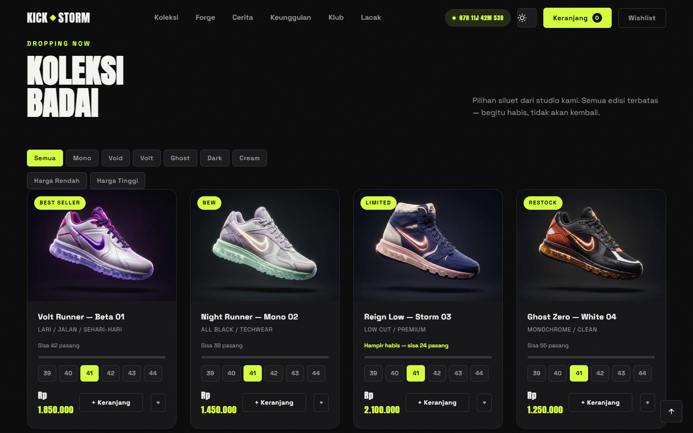
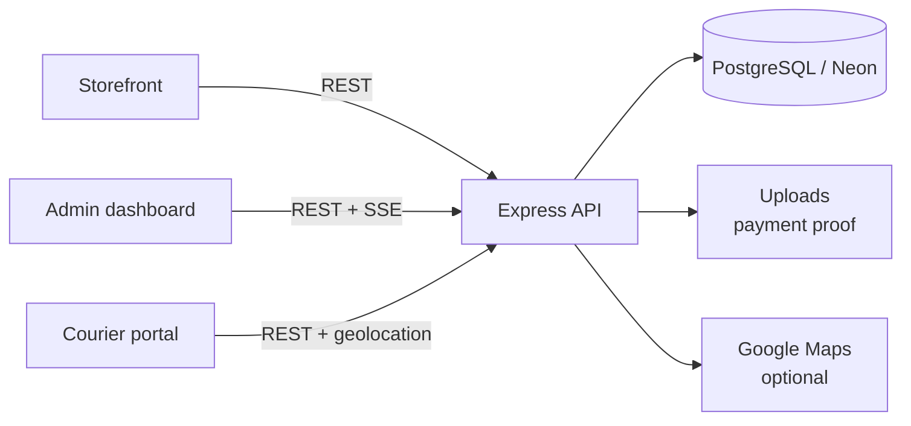

<p align="center">
  
</p>

<h1 align="center">KICKSTORM</h1>

<p align="center">
  <strong>A premium sneaker storefront with a real checkout, courier tracking, and an operations dashboard.</strong>
</p>

<p align="center">
  <a href="LICENSE"></a>
  
  
  
  
</p>

KICKSTORM is a full-stack sneaker brand site: a 3D product hero, a customizable
collection, a checkout with payment proof, referral and membership mechanics,
a courier portal with live location sharing, and an admin dashboard for running
the store.

The project is intentionally dependency-light on the frontend — plain HTML,
CSS, and JavaScript — with an Express API and PostgreSQL in the back.

## Features

| Area | What it does |
| --- | --- |
| **Storefront** | Three.js hero, collection grid, product detail pages, the Forge customizer, lookbook sections, drop countdown, wishlist, and cart. |
| **Commerce** | Checkout with shipping details, coupons, referrals, flash sales, member points, QRIS/transfer payment proof, and order tracking. |
| **Fulfillment** | Admin order pipeline, tracking numbers, courier assignment, courier portal, live courier location, and shareable tracking links. |
| **Admin** | Products, orders, payments, coupons, referrals, flash sales, drops, couriers, members, waitlist, store settings, CSV export, and sales analytics. |
| **Security** | Helmet headers, rate limiting, HMAC-signed admin tokens, password rotation, and no public database dumps. |

## Architecture



- **Frontend:** static HTML/CSS/JS, Three.js, GSAP + ScrollTrigger for motion.
- **Backend:** Express 5, `pg`, `@libsql/client` for local SQLite, Helmet, compression, rate limiting.
- **Database:** PostgreSQL in production; SQLite/LibSQL for local development and tests.
- **Deployment:** Vercel (`vercel.json`) with Neon PostgreSQL.

## Quick start

Requirements: Node.js 18+ and a PostgreSQL database (Neon works well).

```bash
npm ci
cp .env.example .env
# edit .env: DATABASE_URL and ADMIN_PASSWORD
```

Create the schema:

```bash
psql "$DATABASE_URL" -f schema.sql
```

On PowerShell:

```powershell
psql $env:DATABASE_URL -f schema.sql
```

Run the app:

```bash
npm run dev
# http://localhost:3000
```

Routes:

- `/` — storefront
- `/admin` — admin dashboard
- `/courier` — courier portal

Without `DATABASE_URL`, the app uses a local SQLite database under `data/`.
That path is git-ignored because it can contain customer data.

## Tests

```bash
npm test
```

The API test suite uses a temporary SQLite database and does not touch your
development or production data.

## Deployment

1. Create a Neon PostgreSQL database and run `schema.sql`.
2. Import the repository into Vercel. `vercel.json` maps the static site and
   the Express API.
3. Set `DATABASE_URL`, `ADMIN_PASSWORD`, and optionally `GOOGLE_MAPS_API_KEY`
   in the Vercel project.
4. Set `NODE_ENV=production`. The server refuses to start without an admin
   password in production.
5. For uploaded payment proof, use object storage in production. Vercel's
   filesystem is ephemeral.

## Security notes

- Change `ADMIN_PASSWORD` before deploying. The development fallback is not a
  production password.
- Never commit `.env`, `data/`, database backups, or payment uploads.
- Rotating `ADMIN_PASSWORD` invalidates existing admin tokens because tokens
  are signed with it.
- Restrict the Google Maps API key to your production domain.

## License

Released under the [ISC License](LICENSE).
